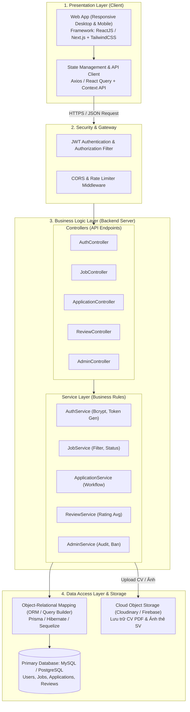
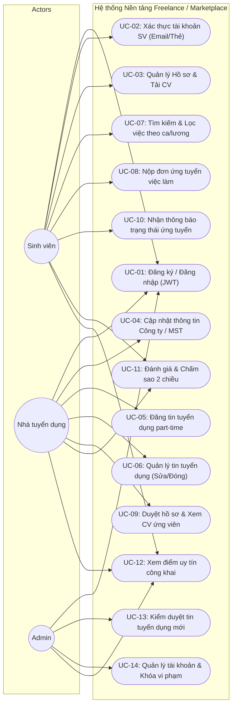

# HƯỚNG DẪN HOÀN THÀNH TRỌN VẸN BUỔI 4: THIẾT KẾ KIẾN TRÚC TỔNG THỂ
**Môn học:** Chuyên đề Tốt nghiệp 2  
**Đề tài:** Nền tảng quản lý freelance / marketplace việc làm part-time cho sinh viên  
**Chuyên ngành:** Công nghệ Phần mềm (CNPM)  
**Thành viên:**  
- **Nguyễn Minh Phú** (MSSV: 2374802013447) - Nhóm trưởng / Backend, Database & System Architecture  
- **Hà Đại Vĩ** (MSSV: 2374802010551) - Thành viên / Frontend, UI/UX & Use Case Modeling  

---

## 🎯 1. MỤC TIÊU VÀ SẢN PHẨM BÀN GIAO BUỔI 4

Theo slide bài giảng **`Buoi04_ChuyenDeTotNghiep2.pdf` (Trang 9)**, nhóm cần bàn giao:
1. **Sơ đồ kiến trúc hệ thống tổng thể (System Architecture Diagram):** Phân tầng rõ ràng Client - API Gateway/REST API - Business Logic - Data Access - CSDL.
2. **Sơ đồ Use Case tổng thể (Use Case Diagram):** Ánh xạ cho 3 Actor (Sinh viên, Nhà tuyển dụng, Admin) từ 14 FRs ở Buổi 2.
3. **Bảng công nghệ (Tech Stack) đã chọn kèm lý do & Phương án B:** Lựa chọn công nghệ khả thi trong 10 buổi.
4. **Nhật ký thực hiện đề tài Buổi 4:** Cập nhật trên file Excel.
5. **Kịch bản thuyết trình bảo vệ phương án kiến trúc (2-3 phút) trước lớp.**

---

## 🏗️ 2. SƠ ĐỒ KIẾN TRÚC HỆ THỐNG TỔNG THỂ (SYSTEM ARCHITECTURE)

Hệ thống áp dụng mô hình **Kiến trúc Phân lớp (Layered Architecture / 3-Tier Client-Server)** kết hợp **RESTful API**, đảm bảo tính độc lập giữa Giao diện người dùng và Xử lý nghiệp vụ:

### Giải thích các phân tầng kiến trúc:
1. **Presentation Layer (Tầng Giao diện - Vĩ phụ trách):**
   * Xây dựng bằng **ReactJS / Next.js**, thiết kế giao diện theo chuẩn Responsive trên thiết bị di động và máy tính với **TailwindCSS**.
   * Quản lý trạng thái và đồng bộ dữ liệu API mượt mà qua **Axios** và **React Query**.
2. **Security & API Gateway Layer (Tầng Bảo mật - Phú phụ trách):**
   * Kiểm soát quyền truy cập theo từng Role (`Student`, `Employer`, `Admin`) thông qua **JSON Web Token (JWT)**.
   * Ngăn chặn truy cập trái phép bằng bộ lọc CORS và giới hạn tần suất gửi yêu cầu (Rate Limiting).
3. **Business Logic Layer (Tầng Nghiệp vụ - Phú phụ trách):**
   * Viết bằng **Node.js (Express) / Java (Spring Boot)**, tiếp nhận các yêu cầu REST API, thực hiện kiểm tra logic (ví dụ: sinh viên chỉ được ứng tuyển việc còn hạn, tính điểm uy tín trung bình sau khi đánh giá).
4. **Data Access & Storage Layer (Tầng Lưu trữ - Phú phụ trách):**
   * Cơ sở dữ liệu quan hệ **MySQL / PostgreSQL** lưu trữ các bảng có tính ràng buộc toàn vẹn cao.
   * Dịch vụ **Cloud Storage (Cloudinary/Firebase Storage)** dùng để lưu file CV PDF và hình ảnh Thẻ sinh viên để xác thực.

---

## 🎯 3. SƠ ĐỒ USE CASE TỔNG THỂ (USE CASE DIAGRAM)

Sơ đồ thể hiện đầy đủ 3 Actor và các chức năng tương ứng từ 14 FR đã đặc tả:

---

## 💻 4. BẢNG CÔNG NGHỆ (TECH STACK) LỰA CHỌN & PHƯƠNG ÁN DỰ PHÒNG

Theo nguyên tắc của Slide Buổi 4: **"Ưu tiên công nghệ nhóm đã có kinh nghiệm hơn công nghệ mới nhưng hot"**:

| Thành phần | Công nghệ lựa chọn (Phương án A) | Lý do lựa chọn (Ưu điểm thực tế) | Phương án dự phòng (Phương án B) |
| :--- | :--- | :--- | :--- |
| **Frontend UI** | **ReactJS + TailwindCSS** | • Cả 2 thành viên đều đã học qua môn Lập trình Web. • Thư viện giao diện phong phú, hỗ trợ Responsive Mobile cực nhanh. • Phù hợp với năng lực của Vĩ để hoàn thành đúng hạn 10 buổi. | **Vue.js / Next.js** (Nếu cần SSR/SEO). |
| **Backend REST API** | **Node.js (Express.js)** *(hoặc Spring Boot)* | • Cú pháp JavaScript đồng nhất với Frontend. • Khởi tạo API REST nhanh chóng, nhẹ, cộng đồng hỗ trợ lớn. • Phù hợp năng lực của Phú để dựng xong API trong Buổi 6–7. | **Java Spring Boot / Python FastAPI** (Nếu GV yêu cầu cấu trúc nghiêm ngặt hơn). |
| **Database** | **MySQL / PostgreSQL** | • Cơ sở dữ liệu quan hệ chuẩn ACID, phù hợp nghiệp vụ tuyển dụng (User - Job - Application). • Dễ dàng thiết kế ERD và viết truy vấn JOIN. | **SQLite / Supabase** (Nếu triển khai Cloud gặp khó khăn). |
| **Xác thực (Auth)** | **JSON Web Token (JWT) + Bcrypt** | • Stateless, dễ mở rộng, bảo mật cao. • Phân quyền 3 Roles (`Student`, `Employer`, `Admin`) đơn giản. | **Session-based Authentication**. |
| **Lưu trữ tệp (Files)** | **Cloudinary API** | • Hỗ trợ upload ảnh đại diện và file CV PDF miễn phí qua API. • Không làm nặng server backend. | **Lưu trữ trực tiếp thư mục `uploads/` trên server**. |
| **Triển khai (Deploy)** | **Vercel (FE) + Render / Railway (BE)** | • Miễn phí, hỗ trợ CI/CD tự động từ GitHub, chạy online ổn định. | **Deploy Localhost kèm video demo dự phòng**. |

---

## 🎙️ 5. CÂU HỎI THẢO LUẬN NHANH VỚI GVHD (SLIDE TRANG 11)

Chuẩn bị sẵn câu trả lời nếu Giảng viên hỏi nhanh nhóm tại lớp:

### ❓ Câu 1: Thành phần nào trong kiến trúc có nguy cơ trở thành điểm nghẽn (bottleneck) nhất?
* **Trả lời của nhóm:**  
  *"Thưa Thầy, điểm nghẽn tiềm ẩn lớn nhất là tính năng **Tìm kiếm & Lọc việc làm theo nhiều tiêu chí (Địa điểm, Ca làm, Mức lương)** và **Upload file CV PDF**.  
  Để khắc phục, nhóm xử lý:
  1. Với tìm kiếm: Nhóm đánh chỉ mục (**Index**) trên các trường thường xuyên tìm kiếm như `district`, `salary`, `job_type` trong CSDL MySQL.
  2. Với file CV: Không lưu trực tiếp file vào database mà tải lên **Cloudinary**, database chỉ lưu URL chuỗi ngắn để tối ưu tốc độ truy vấn."*

### ❓ Câu 2: Nếu công nghệ đã chọn gặp vấn đề không giải quyết được, nhóm có phương án B nào không?
* **Trả lời của nhóm:**  
  *"Thưa Thầy, nếu phần triển khai Backend trên Cloud (Render/Railway) gặp sự cố mạng hoặc giới hạn gói miễn phí, nhóm có **Phương án B** là sử dụng **Supabase Database Cloud** kết hợp chạy Backend trên môi trường local qua công cụ đường hầm an toàn **ngrok/Cloudflare Tunnel** để demo trực tiếp mượt mà cho Hội đồng."*

---

## 🎤 6. KỊCH BẢN THUYẾT TRÌNH BẢO VỆ PHƯƠNG ÁN THIẾT KẾ (2-3 PHÚT)

> *"Kính chào Thầy và các bạn! Nhóm em gồm 2 thành viên: Nguyễn Minh Phú và Hà Đại Vĩ. Hôm nay nhóm xin bảo vệ Phương án Thiết kế Kiến trúc cho đề tài: **Nền tảng marketplace việc làm part-time cho sinh viên**.*
> 
> * **1. Về Mô hình Kiến trúc:** Nhóm lựa chọn mô hình **Kiến trúc phân lớp 3-Tier Client-Server** kết hợp **REST API**. Giao diện Web Client tách biệt hoàn toàn với Server nghiệp vụ:
>   * Tầng Giao diện do bạn Vĩ phụ trách sử dụng **ReactJS + TailwindCSS** để đảm bảo Responsive tốt trên điện thoại di động.
>   * Tầng Nghiệp vụ và CSDL do bạn Phú phụ trách sử dụng **Node.js REST API + MySQL**, phân quyền 3 Role qua **JWT Token** và mã hóa mật khẩu Bcrypt.
> * **2. Về Luồng xử lý dữ liệu:** Người dùng gửi yêu cầu qua giao thức HTTPS $\rightarrow$ Bộ lọc bảo mật JWT kiểm tra vai trò $\rightarrow$ Controller điều phối xuống Service xử lý logic $\rightarrow$ Truy xuất CSDL MySQL. File CV PDF được đẩy thẳng lên Cloud Storage để server luôn nhẹ và phản hồi dưới 2 giây.
> * **3. Về Tính khả thi:** Toàn bộ công nghệ được chọn đều là công cụ cả 2 thành viên đã từng làm quen, không chọn công nghệ quá phức tạp để đảm bảo hoàn thành đúng mốc giữa kỳ ở Buổi 5 tới.
> 
> *Nhóm em rất mong nhận được góp ý của Thầy để hoàn thiện chi tiết CSDL và Figma ở Buổi 5. Em xin cảm ơn Thầy!"*
